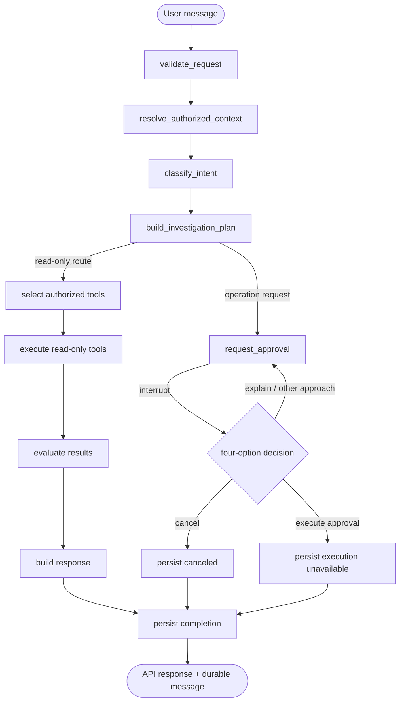

# Final Agent Architecture

Status: Prompt 5 integration and hardening baseline, 4 November 2026.

This document describes the implemented single-agent workflow. It does not introduce a
second agent, an unrestricted executor, Redis, Celery, or deployment behavior.

## A. Component architecture

```text
React Chat UI
    |
    v
FastAPI conversation/auth APIs
    |
    +--> conversation ownership, scopes, reply idempotency and audit events
    |
    v
AgentOrchestrator (compatibility subclass of SingleAgent)
    |
    v
LangGraph StateGraph + PostgreSQL checkpoint saver (optional dedicated database)
    |
    +--> request validation and refreshed authorization
    +--> deterministic/model intent classification
    +--> application-owned investigation plan
    +--> frozen ToolRegistry through ToolGateway
    +--> read-only SAP BTP / knowledge tools
    +--> evidence validation and deterministic diagnosis
    +--> bounded DeepSeek explanation/response generation
    +--> safe completion state
    |
    +--> PostgreSQL conversations, messages, scoped long-term memories, approvals, audits
```

`AgentContext` contains runtime-only sessions, clients and principals. `AgentGraphState`
contains bounded identifiers, route, plan, tool summaries, evidence, findings, counters and
the response. Runtime clients, credentials, tokens and raw provider payloads are not checkpoint
state.

## B. LangGraph workflow



Every node checks cancellation, iteration and checkpoint-size limits. The orchestrator locks a
thread in-process; the database reply claim and message uniqueness protect API retries across
workers. A resumed graph refreshes grants before it can use the saved scope.

## C. State and checkpoint design

State is a frozen Pydantic contract with bounded lists and serialized-size validation. The
checkpoint stores route metadata and redacted tool summaries, not tool `data`. A checkpoint
thread is derived from authenticated user and conversation IDs. Status endpoints expose a safe
projection and never return raw checkpoint values.

The configured PostgreSQL saver must point to a dedicated checkpoint database. Normal startup
uses the configured saver; tests use an in-memory saver or an isolated database. No exactly-once
guarantee is made for an external HTTP call interrupted inside a graph node.

## D. Conversation and long-term memory

Short-term context is assembled from the owned conversation, newest bounded turns, prior tool
summaries and the selected BTP context. Long-term memories are a separate PostgreSQL model with
owner, BTP scope, verification state, expiry, deletion and source-reference fields. Retrieval is
scope-filtered before ranking, bounded, redacted, and injected as untrusted retrieved content.

Memory is not document RAG. Knowledge citations are reauthorized when an assistant reply is
read, so revocation does not expose old document content.

## E. DeepSeek context construction

DeepSeek is used for classification fallback, general responses, and optional diagnosis
explanation. Prompts use fixed instructions plus explicitly delimited untrusted user, history,
memory and tool-result blocks. Credentials and provider tokens are redacted. Structured model
outputs use strict Pydantic contracts; invalid output is rejected rather than repaired by guess.

DeepSeek may explain verified diagnosis findings, but it does not select arbitrary tools, grant
permissions, assert live evidence, or execute operations. Deterministic results remain useful
when DeepSeek is unavailable.

## F. SAP BTP tool orchestration

The frozen registry contains only server-registered read tools. ToolGateway validates the tool
name and bounded arguments, enforces call budgets, and delegates authorization to the server-side
principal and BTP scope. Environment selection is resolved from authorized catalog data; model
output cannot select an untrusted environment.

The Cloud Foundry connector is bounded, same-origin constrained, retry-limited and read-only.
Provider failures are normalized into safe typed results without leaking provider response bodies.

## G. Diagnosis and evidence rules

Phase 13 rules classify observations such as stopped applications, zero running instances,
instance mismatches, process anomalies, repeated crashes, health-check failures, deployment
events, missing service relationships and partial provider failures. Findings include a resource
reference, evidence references, timestamp, severity, confidence, possible causes, missing
evidence and next steps.

`CONFIRMED` is reserved for facts supported by connector evidence. Correlation is `LIKELY` and
unproven causes are `POSSIBLE`; incomplete evidence is `UNKNOWN`. For example, “application
stopped” is an observed condition; insufficient memory remains a possible cause unless the
connector supplies supporting evidence.

## H. Approval lifecycle

Operation requests create one owner/conversation/thread-bound, fingerprinted proposal and pause
the graph. The choices are:

1. Execute: records approval, then returns `execution_unavailable`; no operation runs.
2. Cancel: records cancellation, resumes the graph to a canceled terminal state, and makes no change.
3. Other Approach: records an audit event, keeps the original proposal pending, and does not reuse authorization.
4. Explain Command: records an audit event, explains the proposal, and keeps it pending.

Decisions recheck owner, thread, conversation, current approval status, expiry and active grants.
Terminal approvals cannot be replayed. Fingerprints bind canonical arguments to the user, thread,
conversation and operation type.

## I. Exact execution limitations

There is no authorized command executor. No shell, SAP write, deployment, restart, scale, delete,
or infrastructure-changing operation is exposed. An Execute choice is an approval record only;
the API explicitly reports that no infrastructure change was made.

External DeepSeek and connector calls can repeat if a process dies after the upstream call and
before checkpoint persistence. Application message replies, approvals and selected persistence
paths are deduplicated; read-only upstream repetition remains a documented possibility.

## J. Security boundaries

- Authentication and conversation ownership are enforced before graph work.
- Grants are refreshed on graph resume; revoked BTP scope fails closed.
- Tool names and arguments are server-controlled and bounded.
- Checkpoints, prompts, memory and logs exclude credentials and raw secrets.
- Model text is untrusted and cannot authorize tools or approvals.
- Approval records are owner/thread/fingerprint/expiry bound.
- Knowledge citations are reauthorized at read time.
- Shell and infrastructure mutation are absent by design.

## K. Test matrix

| Area | Evidence | Result |
|---|---|---|
| Backend regression | pytest against isolated PostgreSQL | 400 existing tests passed before Prompt 5 additions |
| Prompt 5 evaluation | deterministic local fakes | 38 scenarios passed |
| Approval hardening | isolated PostgreSQL API integration | 4 approval tests passed |
| Frontend | Vitest | 78 tests passed |
| TypeScript/build/lint | `tsc -b`, Vite, Ruff | passed |
| Checkpoint persistence | isolated PostgreSQL checkpoint test | passed in backend regression |
| Browser workflow | browser bridge | not verified; bridge unavailable |
| Live SAP | real provider | not tested by design |
| Paid/live DeepSeek | real model | not used by evaluation suite |

## L. Evaluation results

The deterministic evaluation suite contains 38 scenarios covering routing, model structured
classification, malformed output, invalid arguments, state bounds, mocked Cloud Foundry
diagnosis, evidence confidence, memory/prompt trust boundaries, redaction and approval
fingerprints. It is a contract and hardening scorecard, not a benchmark of real DeepSeek
intelligence.

## M. Remaining defects

Browser E2E remains unverified because the browser access host was unavailable. Live SAP API
behavior and real DeepSeek reasoning quality remain unverified. The system does not provide
exactly-once semantics for an interrupted external read-only call.

## N. Unsupported capabilities

Unrestricted terminal commands, command execution, SAP writes, deployments, restarts, scaling,
deletion, live infrastructure mutation, Redis/Celery workers, and automatic long-term memory of
unverified hypotheses are unsupported.

## O. Future improvements

Add a supported browser harness, run a non-production SAP connector contract environment, add
durable upstream idempotency keys where providers support them, and collect a labeled real-world
question set for measuring DeepSeek classification and explanation quality separately from these
deterministic contract tests.
